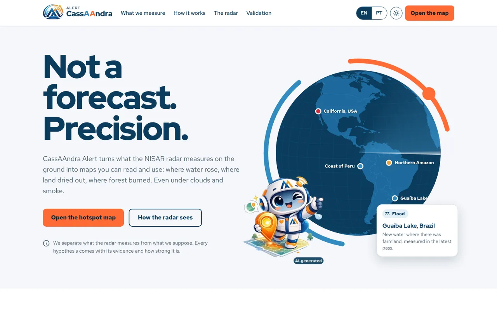
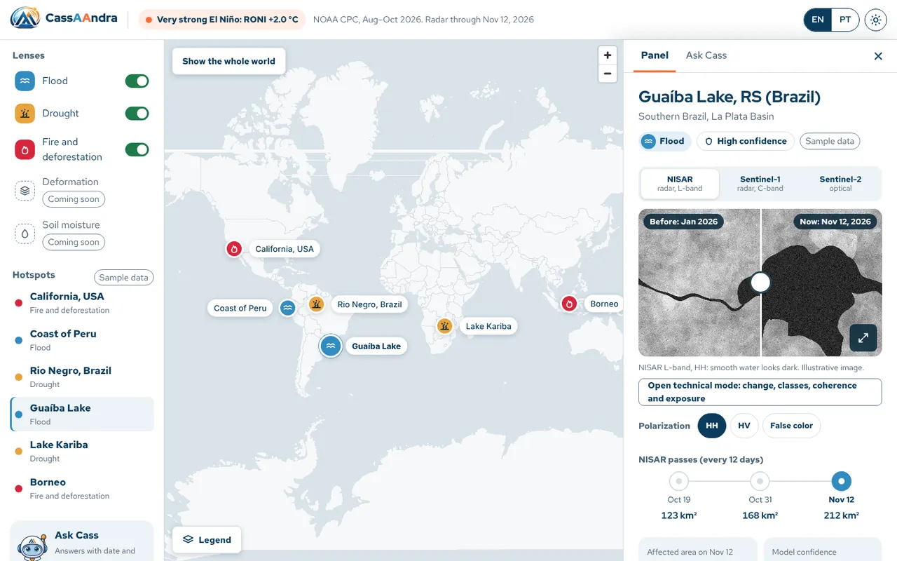
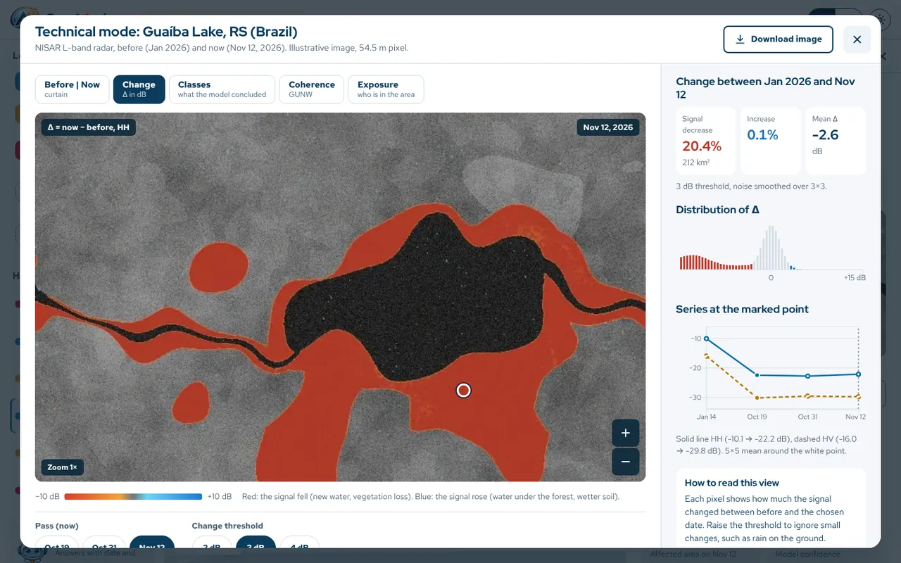
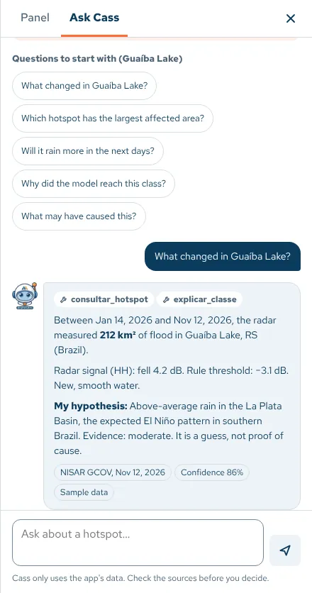
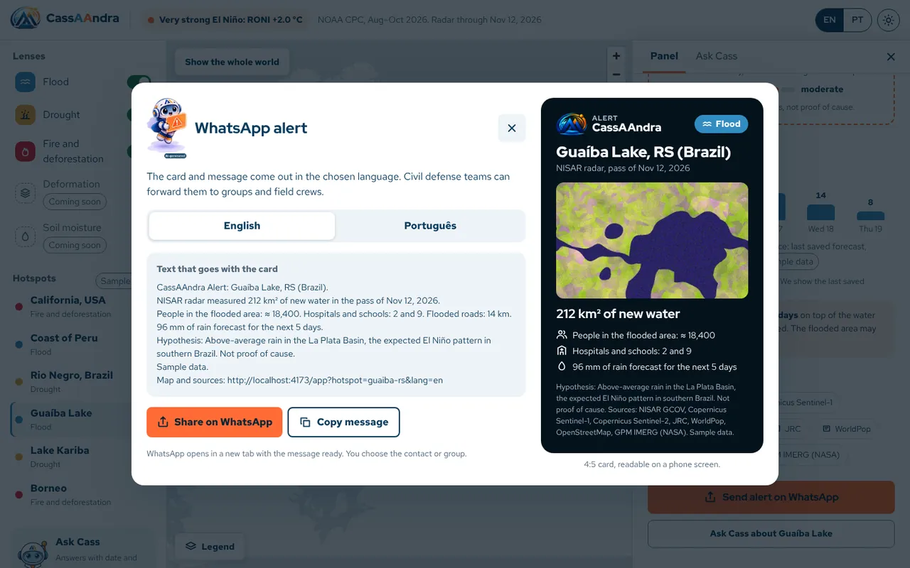
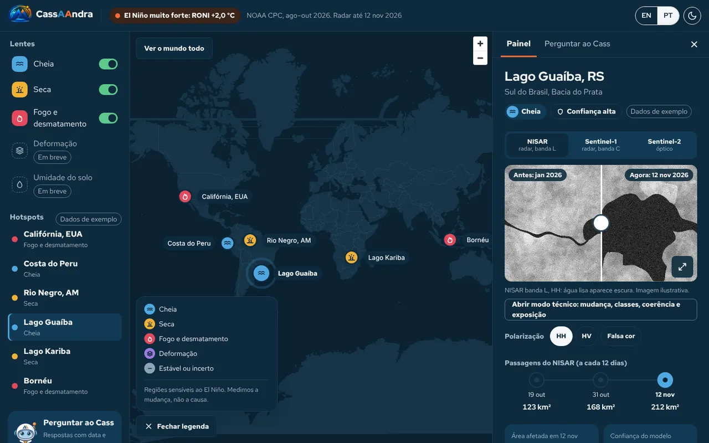
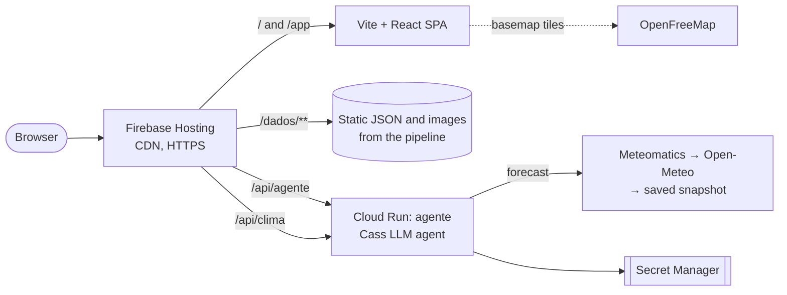
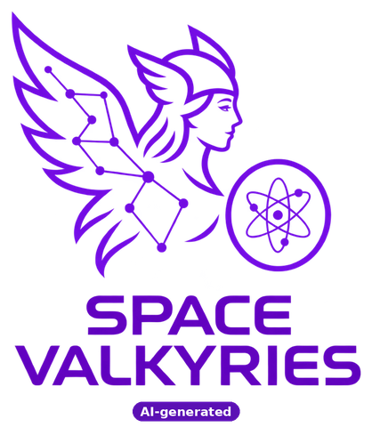

# CassAAndra Alert

**Not a forecast. Precision.**

CassAAndra Alert turns what the NISAR radar measures on the ground into maps anyone can read: where water rose, where land dried out, where forest burned. It works under clouds and smoke. Built by team **Space Valkyries** for the **NASA Space Apps Challenge 2026**, challenge _Dancing with the SARs_.

[**Open the app →**](https://cassaandra-alert.web.app) · [Map](https://cassaandra-alert.web.app/app) · [Versão em português](https://cassaandra-alert.web.app/?lang=pt)

[](https://github.com/Montezi/cassaandra-alert-frontend/actions/workflows/ci.yml)
[](LICENSE)



> **Sample data.** Until the radar pipeline publishes real results, the numbers and images in the app are illustrative samples. The app labels them on screen.

## Why

El Niño 2026 is very strong (RONI +2.0 °C, NOAA CPC). It brings floods to some regions and drought and fire to others. Optical satellites cannot see through the clouds of a flood or the smoke of a fire. Radar can.

In May 2024 we watched the Guaíba rise higher than ever recorded and Porto Alegre go under water. That is why Guaíba Lake is the first place Cass watches. But radar has no borders: the same method measures fire in California and drought in southern Africa.

## What it does

|                            |                                                                                                                                                                                                                         |
| -------------------------- | ----------------------------------------------------------------------------------------------------------------------------------------------------------------------------------------------------------------------- |
| **Global map of hotspots** | Six regions sensitive to El Niño, each with the class the radar measured: flood, drought, or fire and deforestation. Every class has an icon and a name as well as a color.                                             |
| **Hotspot panel**          | Before/now curtain per sensor (NISAR L-band, Sentinel-1 C-band, Sentinel-2 optical), HH/HV/false-color polarization, the NISAR passes every 12 days with the affected area of each, and who lives in the affected area. |
| **Measured × Hypothesis**  | What the radar measured (solid box, with source and date) is kept apart from what may explain it (dashed box, with the evidence and its strength: weak, moderate or strong).                                            |
| **Technical mode**         | Change map in dB with 2/3/4 dB thresholds, classes, coherence and exposure, plus the change histogram and the HH/HV series at a marked point.                                                                           |
| **Ask Cass**               | A chat agent that answers only with measured data, always with date and source.                                                                                                                                         |
| **WhatsApp alert**         | A card and a ready message, in English or Portuguese, for civil defense teams to forward.                                                                                                                               |
| **Rain forecast**          | The next 5 days, always with the source (Meteomatics, Open-Meteo or the last saved forecast) and its update time. A forecast older than 3 days never triggers an alert.                                                 |



<table>
  <tr>
    <td width="68%"></td>
    <td></td>
  </tr>
  <tr>
    <td>Technical mode</td>
    <td>Ask Cass</td>
  </tr>
</table>



Light and dark themes, English and Portuguese:



> Screenshots: sample data. The basemap in these images is a simplified stand-in; the live app uses OpenFreeMap with place names in the chosen language.

## Hotspots

| Hotspot                                    | El Niño effect              | Class                  |
| ------------------------------------------ | --------------------------- | ---------------------- |
| Norte Fire, San Clemente, California (USA) | wetter winter               | Fire and deforestation |
| Piura, northern coast of Peru              | coastal El Niño, heavy rain | Flood                  |
| Rio Negro, Amazonas (Brazil)               | drought                     | Drought                |
| Guaíba Lake, RS (Brazil)                   | above-average rainfall      | Flood                  |
| Lake Kariba, Zambia and Zimbabwe           | drier until March           | Drought                |
| Central Kalimantan, Borneo                 | drought and peatland fires  | Fire and deforestation |

## How it works

1. **Search.** Find the NISAR passes before (early 2026) and now over each hotspot.
2. **Crop.** Download only the hotspot area, not the whole multi-GB file.
3. **Measure.** Compute the change in backscatter (HH and HV), the coherence and the accumulated rain.
4. **Classify.** An explainable decision tree labels each cell: flood, drought, fire, deformation or stable.
5. **Explain.** Cass separates what was measured from the hypothesis about the cause, always with date and source.

A Python pipeline (separate repository) does steps 1 to 4 and publishes static JSON and images. This repository is the web app that reads them.

## Architecture



- **Static first.** The app only reads files the pipeline already computed, so it loads fast on slow 4G and has no database.
- **Same origin.** `/api/*` goes through Hosting rewrites to Cloud Run, so the browser needs no CORS and no API key ever reaches it.
- **Graceful fallbacks.** If `/api/clima` is down, the app shows the last saved forecast with its date. If `/api/agente` is not deployed, the chat switches to a clearly marked demo mode that builds answers from the same data, without AI.

## Data sources

**NASA:** NISAR (NASA and ISRO, via ASF), GPM IMERG, FIRMS. **NOAA:** CPC (RONI index). **Copernicus:** Sentinel-1, Sentinel-2. **Other:** ESA WorldCover, JRC Global Surface Water, DETER/INPE, CHIRPS, WorldPop, OpenStreetMap, Meteomatics, Open-Meteo. **Basemap:** OpenFreeMap and OpenStreetMap contributors.

## Tech stack

- [Vite 8](https://vite.dev), [React 19](https://react.dev) and TypeScript (strict)
- [MapLibre GL JS 6](https://maplibre.org) for the map and [Recharts 3](https://recharts.org) for the charts
- [react-i18next](https://react.i18next.com) for English and Portuguese
- [zod 4](https://zod.dev) to validate every data file and API answer
- Firebase Hosting and Cloud Run on Google Cloud, deployed by GitHub Actions

## Getting started

Requires **Node.js 22.12 or later**.

```bash
npm ci
npm run dev
```

Open http://localhost:5173. The app reads the sample data in `public/dados`.

In development, Vite forwards `/api/*` to `http://localhost:8080`. To use another backend, copy `.env.example` to `.env.local` and set `API_PROXY_TARGET`. Never put API keys in this repository: they live in Secret Manager.

| Command             | What it does                                     |
| ------------------- | ------------------------------------------------ |
| `npm run dev`       | Development server with the `/api` proxy         |
| `npm run build`     | Production build in `dist/`                      |
| `npm run preview`   | Serves the production build locally              |
| `npm run lint`      | ESLint, including accessibility rules (jsx-a11y) |
| `npm run typecheck` | TypeScript type check                            |
| `npm run format`    | Prettier                                         |

## Project structure

```
src/
  app/          pages, header, El Niño badge
  features/
    landing/    landing page
    mapa/       map, markers, lenses, legend, hotspot list
    painel/     hotspot panel: images, timeline, Measured × Hypothesis, forecast
    tecnico/    technical mode
    cass/       Cass chat and demo mode
    alerta/     WhatsApp alert card and message
  shared/
    i18n/       en.json, pt.json
    theme/      design tokens (tokens.css), light/dark theme
    lib/        data loading, zod schemas, URL state, formatting
    ui/         shared components and icons
public/
  dados/        data from the pipeline (sample data today)
  img/          brand, Cass poses, landing images
docs/
  adr/          architecture decision records
  data-contract.md
  api-contract.md
```

## Data and API contracts

- [`docs/data-contract.md`](docs/data-contract.md): the files the pipeline publishes in `/dados` (hotspots, statistics, forecast snapshot, El Niño index).
- [`docs/api-contract.md`](docs/api-contract.md): requests and answers of `/api/agente` and `/api/clima`, and how the app reacts to each answer.

The app validates every file and answer against these contracts. A file that breaks a rule shows an error state instead of wrong numbers.

## Deployment

Every push to `main` runs lint, typecheck and build, then deploys to Firebase Hosting. GitHub authenticates to Google Cloud with **Workload Identity Federation**, so no service account key is stored anywhere.

Manual deploy:

```bash
npm run build
firebase deploy --only hosting
```

## Accessibility, security and performance

- Keyboard navigation, visible focus, WCAG AA contrast in both themes, a text list of every hotspot next to the map, and `prefers-reduced-motion` respected.
- English by default. A link with `?lang=pt` opens in Portuguese, and the language stays in shared links.
- Strict Content-Security-Policy and security headers in `firebase.json`. No secrets in the frontend.
- The map, the technical mode, the chat and the alert load on demand, and images are WebP.

## Architecture decisions

| ADR                                               | Decision                                           |
| ------------------------------------------------- | -------------------------------------------------- |
| [001](docs/adr/001-vite-react-typescript.md)      | Vite + React + TypeScript single-page app          |
| [002](docs/adr/002-firebase-hosting-cloud-run.md) | Firebase Hosting for the app, Cloud Run for `/api` |
| [003](docs/adr/003-maplibre.md)                   | MapLibre GL for the map                            |
| [007](docs/adr/007-i18n-and-themes.md)            | Internationalization (EN/PT) and light/dark themes |

## Team

<p align="center">
  
</p>

Made by **Space Valkyries** (Ana, Aline and Mirian) for the NASA Space Apps Challenge 2026.

The CassAAndra symbol has two A's, for Ana and Aline. Where they cross, they form the M of Mirian.

**Cass**, our mascot, is the chat agent.

**AI-generated images:** Cass, the CassAAndra symbol and the Space Valkyries logo are AI-generated. The Cass images and the team logo in this README carry an "AI-generated" label.

This is a team project for the NASA Space Apps Challenge. It is not affiliated with or endorsed by NASA.

## Use of AI

- **Images:** Cass, the CassAAndra symbol and the illustrative radar images (before/now, technical layers, alert card) are AI-generated or made by AI-written code. In the app, they carry an "AI-generated" label, and the header and footer link to an **AI credits** dialog listing every use.
- **Data:** the sample files in `public/dados` were put together with AI assistance and carry `"ai_generated": true` in their `metadata`.
- **Code:** developed with AI coding assistants (Claude); the team reviewed and approved each change, and assisted commits carry a `Co-Authored-By` trailer.
- No AI-generated content uses NASA logos, flags or mission identifiers.

## License

[MIT](LICENSE). Data sources keep their own licenses and terms.
